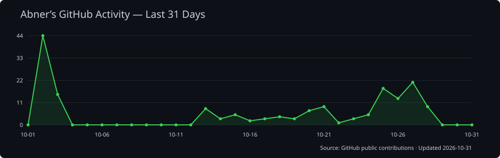

<h1 align="center">Hi there 👋, I'm Abner</h1>

<p align="center">
  <b>Developer / Builder / Lifelong Learner</b><br/>
  专注把想法快速落地成可持续迭代的产品。
</p>

---

## 🙋‍♂️ 关于我

- 👨‍💻 关注方向：**Web 开发、AI 应用、自动化效率工具**
- 🧠 持续提升：系统设计、工程化能力、产品思维
- 🌱 行动方式：长期主义 + 高频复盘 + 小步快跑
- ✨ 目标：打造真正解决问题、值得长期使用的产品

## 🧰 技术栈

<p>
  
  
  
  
  
  
  
  
</p>

---

## 🚀 精选项目

### 🔹 [Abner Music](https://github.com/abner-forever/abner-music)
面向 **macOS / Windows** 的桌面音乐播放器，将本地音乐、网络音频、在线搜索与个人歌单整合在一起。

- **方向**：桌面应用 / 音乐播放与管理
- **技术栈**：Electron Forge / Vue 3 / TypeScript
- **亮点**：本地音乐导入、同步歌词、均衡器、迷你播放器与跨平台构建发布

### 🔹 [夜深 · night_sleep](https://github.com/abner-forever/night_sleep)
本地优先的 **iOS / Android** 睡眠记录应用，提供睡眠统计、助眠音效与夜间录音，睡眠数据和录音保存在设备上。

- **方向**：移动应用 / 睡眠记录与个人数据管理
- **技术栈**：Flutter / Dart / Riverpod / Drift（SQLite）/ TensorFlow Lite
- **亮点**：端侧模型辅助标注疑似鼾声与人声、睡眠趋势统计、完整备份与恢复

### 🔹 [MediaForge · 图文工坊](https://github.com/abner-forever/MediaForge-Electron)
微信公众号内容自动化桌面工具，串联多平台图文发现、AI 评分与写作、草稿管理和发布流程。

- **方向**：内容自动化 / AI 工作流 / 桌面工具
- **技术栈**：Electron / React / TypeScript / Node.js / Express / Playwright
- **亮点**：内置扫码登录、多账号管理、AI 内容创作与文章发布工作台

---

## 📌 当前重点（Now）

- 🔭 正在推进：**AI + 内容生产效率方向的产品化尝试**
- 🌍 近期关注：**全栈工程化、可维护性、用户体验优化**
- 🛠️ 当前任务：项目功能迭代、结构优化与发布流程完善
- 🧭 下一目标：稳定版本发布 + 用户反馈闭环

---

## 🗓️ Recent Activity（自动更新）

<!--RECENT_ACTIVITY:start-->
1. ⬆️ Pushed undefined commit(s) to [abner-forever/abner-music](https://github.com/abner-forever/abner-music)<br>
2. ⬆️ Pushed undefined commit(s) to [abner-forever/abner-music](https://github.com/abner-forever/abner-music)<br>
3. ⬆️ Pushed undefined commit(s) to [abner-forever/abner-music](https://github.com/abner-forever/abner-music)<br>
4. ⬆️ Pushed undefined commit(s) to [abner-forever/abner-forever](https://github.com/abner-forever/abner-forever)<br>
5. ⬆️ Pushed undefined commit(s) to [abner-forever/abner-forever](https://github.com/abner-forever/abner-forever)<br>
6. ⬆️ Pushed undefined commit(s) to [abner-forever/abner-music](https://github.com/abner-forever/abner-music)<br>
7. ⬆️ Pushed undefined commit(s) to [abner-forever/abner-music](https://github.com/abner-forever/abner-music)<br>
8. ⬆️ Pushed undefined commit(s) to [abner-forever/abner-music](https://github.com/abner-forever/abner-music)<br>
<!--RECENT_ACTIVITY:end-->

> 该区块由 GitHub Actions 定时更新（每 6 小时）。

---

## 📊 Activity Graph

[](https://github.com/abner-forever)

---

## 📈 开发数据

<!--START_SECTION:waka-->


**🐱 My GitHub Data** 

> 📦 44.1 kB Used in GitHub's Storage 
 > 
> 🏆 213 Contributions in the Year 2026
 > 
> 🚫 Not Opted to Hire
 > 
> 📜 40 Public Repositories 
 > 
> 🔑 2 Private Repositories 
 > 
**I'm an Early 🐤** 

```text
🌞 Morning                318 commits         ████░░░░░░░░░░░░░░░░░░░░░   15.30 % 
🌆 Daytime                884 commits         ███████████░░░░░░░░░░░░░░   42.54 % 
🌃 Evening                712 commits         █████████░░░░░░░░░░░░░░░░   34.26 % 
🌙 Night                  164 commits         ██░░░░░░░░░░░░░░░░░░░░░░░   07.89 % 
```
📅 **I'm Most Productive on Thursday** 

```text
Monday                   318 commits         ████░░░░░░░░░░░░░░░░░░░░░   15.30 % 
Tuesday                  253 commits         ███░░░░░░░░░░░░░░░░░░░░░░   12.18 % 
Wednesday                254 commits         ███░░░░░░░░░░░░░░░░░░░░░░   12.22 % 
Thursday                 565 commits         ███████░░░░░░░░░░░░░░░░░░   27.19 % 
Friday                   207 commits         ██░░░░░░░░░░░░░░░░░░░░░░░   09.96 % 
Saturday                 220 commits         ███░░░░░░░░░░░░░░░░░░░░░░   10.59 % 
Sunday                   261 commits         ███░░░░░░░░░░░░░░░░░░░░░░   12.56 % 
```


📊 **This Week I Spent My Time On** 

```text
💬 Programming Languages: 
No Activity Tracked This Week

🔥 Editors: 
No Activity Tracked This Week

💻 Operating System: 
No Activity Tracked This Week
```

🤖 **AI Coding This Week** 

```text
No AI Coding Activity Tracked This Week
```

**I Mostly Code in JavaScript** 

```text
JavaScript               11 repos            ███████████░░░░░░░░░░░░░░   44.00 % 
TypeScript               6 repos             ██████░░░░░░░░░░░░░░░░░░░   24.00 % 
Vue                      3 repos             ███░░░░░░░░░░░░░░░░░░░░░░   12.00 % 
Dart                     2 repos             ██░░░░░░░░░░░░░░░░░░░░░░░   08.00 % 
Svelte                   1 repo              █░░░░░░░░░░░░░░░░░░░░░░░░   04.00 % 
```


 Last Updated on 01/09/2026 04:06:04 UTC
<!--END_SECTION:waka-->

---

## 🤝 联系方式

- 📮 Email：`abner.foreverheart@gmail.com`

<p align="center">
  <i>Thanks for visiting my profile 🚀</i>
</p>
